# AI Infra Learning Log

> **Junior AI Infrastructure Engineer**가 되기 위한 학습 기록입니다.
> [ai-infra-junior-engineer-learning](https://github.com/ai-infra-curriculum/ai-infra-junior-engineer-learning) 커리큘럼(10 Modules + 5 Projects)을 순서대로 따라가며, 모듈마다 **배운 개념을 내 말로 정리한 노트**와 **직접 작성한 실습 코드**를 남깁니다.


---

## 🎯 목표

ML 모델을 **API로 서빙 → 컨테이너화 → Kubernetes에 배포 → 모니터링 → 클라우드/IaC로 운영**하는 전체 흐름을 직접 구현하고, *왜 그렇게 설계했는지* 설명할 수 있는 엔지니어가 되는 것.

```
Data → Training Pipeline → Model Registry → CI/CD → Docker → Kubernetes/Helm
     → Model Serving → Load Balancing → Monitoring/Alerting → Cloud(Terraform)
```

---

## 📍 현재 상태

| 항목 | 내용 |
|---|---|
| **진행 중** | Module 003 — Git & Version Control (Lesson 4/6) |
| **완료한 모듈** | 001 Python, 002 Linux |
| **다음 마일스톤** | Module 006 완료 후 **Project 01** (첫 포트폴리오 프로젝트) 시작 |
| **마지막 업데이트** | 2026-11 |

```
Modules   ██████░░░░░░░░░░░░░░  2 / 10
Projects  ░░░░░░░░░░░░░░░░░░░░  0 / 5
```

---

## 📚 Module 진도

| Module | 주제 | 핵심 키워드 | 시간 | 상태 | 노트 |
|---|---|---|---|---|---|
| **001** | Python Fundamentals for Infrastructure | venv, logging, 예외 처리, subprocess, argparse, pytest | 15h | ✅ 완료 | [notes](modules/module-001-python-fundamentals/notes) |
| **002** | Linux Essentials | 파일시스템, 권한, 프로세스/시그널, systemd, Bash, 네트워킹 | 15h | ✅ 완료 | [notes](modules/module-002-linux-essentials/notes) |
| **003** | Git & Version Control | 내부 모델, branch/merge, remote, 협업 워크플로우, rebase | 10h | 🔄 진행 중 (4/6) | — |
| **004** | ML Basics (PyTorch/TensorFlow) | 학습 루프, 평가 지표, ONNX/TorchScript, GPU 기초 | 20h | ⬜ 예정 | |
| **005** | Docker & Containerization | 이미지 레이어, multi-stage build, Compose, 리소스 제한 | 15h | ⬜ 예정 | |
| **006** | Kubernetes Introduction | Pod/Deployment/Service, ConfigMap/Secret, Helm, HPA | 20h | ⬜ 예정 | |
| **007** | APIs & Web Services | REST, FastAPI, 인증, rate limiting, Locust 부하 테스트 | 15h | ⬜ 예정 | |
| **008** | Databases & SQL | PostgreSQL, 인덱스/트랜잭션, Redis, SQLAlchemy, Alembic | 15h | ⬜ 예정 | |
| **009** | Monitoring & Logging Basics | SLI/SLO, Prometheus/PromQL, Grafana, 구조화 로깅 | 15h | ⬜ 예정 | |
| **010** | Cloud Platforms (AWS 중심) | IAM, EC2/ECS/EKS, S3/RDS, VPC, Terraform | 20h | ⬜ 예정 | |

---

## 🛠 Hands-on Projects (예정)

프로젝트는 이 레포가 아닌 **프로젝트별 독립 레포**로 진행하고, 완료되면 아래 표에 링크를 연결합니다.

| Project | 무엇을 만드나 | 주요 기술 | 선행 조건 | 시간 | 상태 |
|---|---|---|---|---|---|
| **01** Simple Model API Deployment | 학습된 모델을 REST API로 서빙하고 Docker로 컨테이너화해 클라우드에 배포 | FastAPI, PyTorch, Docker, AWS, PostgreSQL | Module 001–006 | 60h | ⬜ 예정 |
| **02** Kubernetes Model Serving | Project 01의 API를 K8s에 올려 오토스케일링·로드밸런싱·무중단 배포 구성 | Kubernetes, Helm, NGINX Ingress, Prometheus, Grafana | Project 01, Module 006 | 80h | ⬜ 예정 |
| **03** ML Pipeline with Experiment Tracking | 수집→전처리→학습→평가→배포 파이프라인 + 실험/데이터 버전 관리 | MLflow, Airflow/Prefect, DVC, Great Expectations | Project 01–02, Module 007–008 | 100h | ⬜ 예정 |
| **04** Monitoring & Alerting System | ML 인프라 전체의 메트릭·대시보드·중앙 로그·알림 체계 구축 | Prometheus, Grafana, ELK, Alertmanager | Project 01–03, Module 009 | 80h | ⬜ 예정 |
| **05** Production-Ready ML System (Capstone) | 앞의 모든 것을 통합: CI/CD, 보안, 고가용성, 재해 복구 | GitHub Actions, Terraform, cert-manager, Vault, Velero | 전체 | 120h | ⬜ 예정 |

> 포트폴리오 레포 이름은 `project-01` 같은 번호 대신 **기능이 드러나는 이름**으로 짓습니다.

---

## 🗺 학습 경로

```mermaid
flowchart LR
    M1[001 Python]:::done --> M2[002 Linux]:::done --> M3[003 Git]:::now --> M4[004 ML Basics] --> M5[005 Docker] --> M6[006 Kubernetes]
    M6 --> P1([Project 01<br/>Model API])
    P1 --> M7[007 APIs] --> M8[008 DB] --> P2([Project 02<br/>K8s Serving])
    P2 --> M9[009 Monitoring] --> M10[010 Cloud] --> P3([Project 03<br/>ML Pipeline])
    P3 --> P4([Project 04<br/>Monitoring]) --> P5([Project 05<br/>Capstone]) --> J[Portfolio / Job]

    classDef done fill:#2da44e,color:#fff,stroke:#2da44e
    classDef now fill:#fb8500,color:#fff,stroke:#fb8500
```



---

## 📁 레포 구조

```
ai-infra-learning-log/
├── README.md                          # 지금 보고 있는 진도 대시보드
└── modules/
    ├── module-001-python-fundamentals/
    │   ├── notes/                     # 레슨별 노트 (lesson-0X-<주제>.md)
    │   └── exercises/                 # 실습 코드
    ├── module-002-linux-essentials/
    │   ├── notes/
    │   └── exercises/
    └── module-00X-<주제>/             # 모듈을 끝낼 때마다 추가
```

**노트 한 편의 구성**

| 섹션 | 내용 |
|---|---|
| 핵심 개념 | 이 레슨에서 꼭 기억할 것 |
| 동작 원리 | 명령어/기술이 내부적으로 무엇을 바꾸는가 |
| 실습에서 한 것 | 직접 만든 것과 배운 점 |
| Infrastructure 연결 | AI Infra 전체 구조에서 어디에 쓰이는가 |
| 면접 포인트 | 한두 줄 |
| 내 말로 3줄 요약 | 직접 쓴 요약 |

---

## 🔖 기록 규칙

- **모듈 단위로 커밋**합니다. 모듈 작업은 `module-00X-<주제>` 브랜치에서 진행하고, 모듈 평가를 통과하면 `main`에 merge 후 태그를 붙입니다.
- 커밋 메시지
  - `feat(m00X): ...` 실습 코드
  - `docs(m00X): ...` 노트
  - `chore: ...` README 대시보드
- 완료 태그: `module-00X-done` → [Tags](../../tags)에서 모듈별 완료 시점 확인 가능
- 이 레포에는 **배운 내용만** 올립니다. (퀴즈·점수·비밀 정보·대용량 데이터/모델 파일 제외)

---

## 💻 환경

| 구분 | 내용 |
|---|---|
| OS | Windows 11 + WSL2 (Ubuntu) |
| Language | Python 3.12, pytest |
| Container | Docker Desktop (WSL2 backend) |
| Editor | VS Code (WSL integration) |
| Cloud | AWS CLI v2 |
